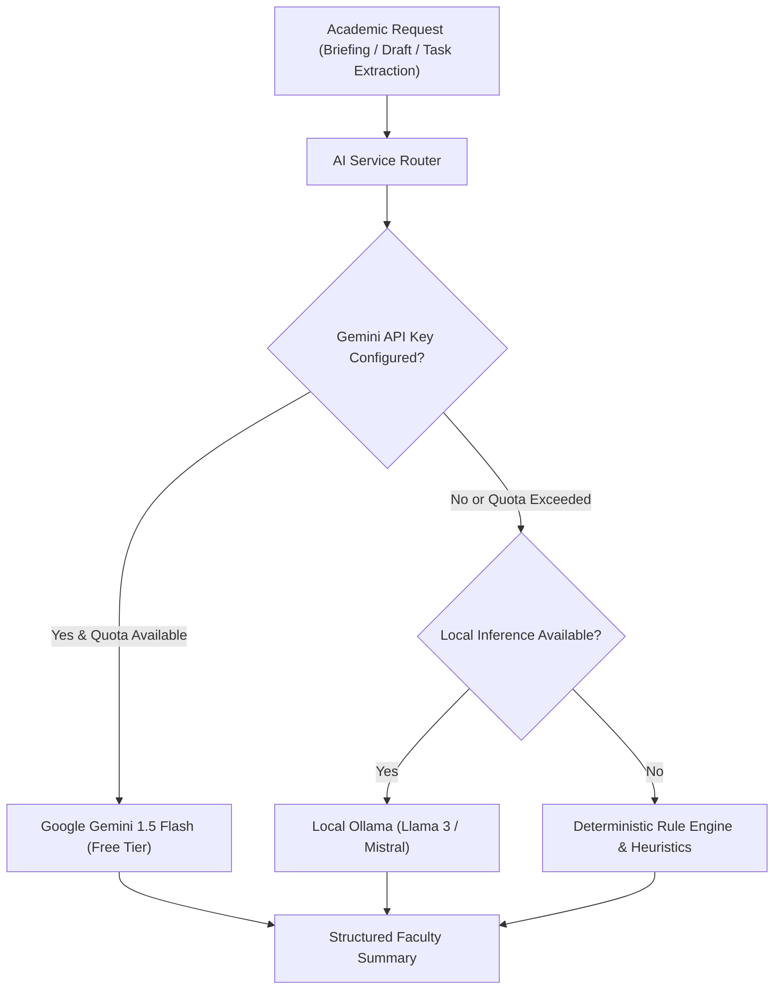

# MaamAI Phase 2: ₹0 Zero-Cost Architecture Plan & AI Provider Strategy

This document details the cost analysis, free-tier limits, quotas, and AI provider fallback strategies for running **MaamAI** at a strict **₹0 budget** without activating paid billing.

---

## 1. Zero-Cost Infrastructure Matrix

| Service Component | Provider | Free Tier Entitlement | MaamAI Projected Utilization | ₹0 Budget Risk & Mitigation |
| :--- | :--- | :--- | :--- | :--- |
| **Frontend CDN & Edge** | **Vercel Hobby** | 100 GB/month bandwidth, unlimited deployments, automatic HTTPS. | ~ 150 MB/month (Static React assets). | **Negligible Risk**: Well within hobby limits for 2 staff members. |
| **Backend API (Serverless)** | **Vercel Functions** | 100,000 function invocations/day, 10s execution timeout per request. | ~ 200–500 invocations/day. | **Low Risk**: Ephemeral cold starts; database queries must remain fast (< 200ms). |
| **Relational Database** | **Supabase Free** | 500 MB PostgreSQL storage, 2 GB egress/month, 60 max connections. | < 5 MB database storage. | **Medium Risk (Inactivity Pause)**: Supabase pauses databases after 7 days of inactivity. Mitigation: Unpause with 1 click in dashboard or configure weekly health ping. |
| **Authentication & Vault** | **MaamAI Backend** | Self-hosted JWT + Fernet AES-128-CBC encryption on Vercel. | Zero external cost. | **No Risk**: Fully open-source; runs entirely in-process. |
| **Google Cloud APIs** | **Google Cloud Platform** | OAuth 2.0 (Unlimited Free), Gmail API (1B quota units/day), Calendar API (1M requests/day). | ~ 100 requests/day for 2 staff accounts. | **No Risk**: Google does not charge for Gmail/Calendar API access within standard quotas. |
| **AI Inference** | **Google AI Studio (Gemini)** | 15 requests/minute, 1,500 requests/day, 1M tokens/minute (100% free, no credit card). | ~ 30–50 requests/day. | **Low Risk**: Handled by graceful deterministic fallbacks. |

---

## 2. AI Provider Architecture & Pluggable Interface

To prevent vendor lock-in and avoid unexpected subscription costs, MaamAI defines an abstract **AI Provider Interface**:

### Supported Providers
1. **Primary Cloud: Google Gemini 1.5 Flash (Free Tier)**
   - Access: Requires free API key from [Google AI Studio](https://aistudio.google.com/).
   - Cost: **₹0** (no billing account required).
   - Rate Limits: 15 RPM / 1,500 RPD.
   - Use Cases: Summarizing daily briefings, drafting warm academic responses, extracting calendar action items from email text.
2. **Local Offline: Ollama (Open Source)**
   - Access: Runs locally on laptop (e.g., `ollama run llama3:8b`).
   - Cost: **₹0** (computational resources only).
   - Privacy: 100% on-device processing; zero data leaves the machine.
3. **Deterministic Fallback Engine**
   - Access: Built into the Python codebase.
   - Mechanism: Regex-based intent extraction, deadline parsing, template-based academic reply drafting, and urgency classification.
   - Integrity Rule: System labels deterministic outputs transparently; never misrepresents rule-based results as live LLM responses.

---

## 3. Privacy & Compliance Policies for Free AI Tiers

Under Google AI Studio's free tier, prompts and completions may be reviewed by human reviewers for safety training (unless an enterprise agreement is in place).

To protect academic confidentiality:
1. **Data Minimization**: Never pass sensitive student grades, personally identifiable student IDs, or disciplinary records to cloud LLMs.
2. **Selective Summarization**: Faculty settings allow toggling cloud AI processing off on a per-module basis (e.g., enable briefing summaries but keep draft generation rule-based).
3. **Explicit Review**: AI-generated email drafts and calendar event suggestions remain in `pending` review status until the faculty member inspects and approves them.

---

## 4. Financial Safeguards: Preventing Accidental Billing

1. **No Credit Card Rule**: Never attach a credit card to Vercel, Supabase, or Google Cloud.
2. **Provider Spending Caps**: On all cloud consoles, maintain hard spending caps set to ₹0.
3. **Graceful Degraded Mode**: If external quotas expire or services pause, the application falls back to simulated offline demo data rather than halting.
